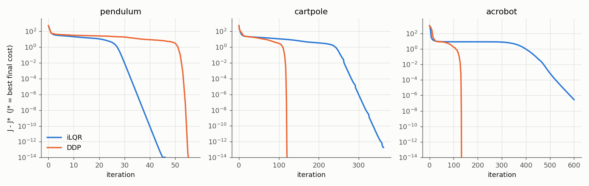
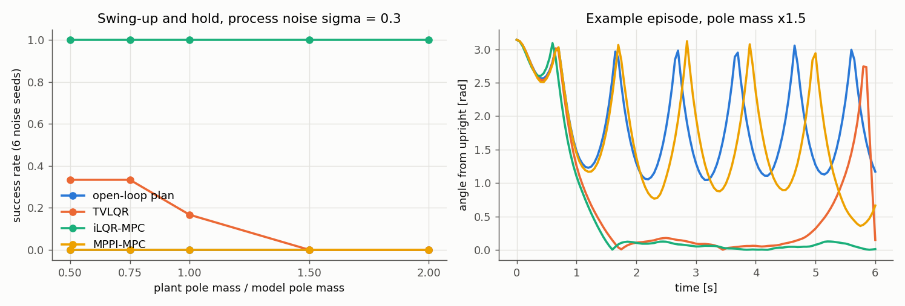

# trajopt-lab

iLQR, full second-order DDP, MPPI, and CEM for underactuated swing-up tasks.
Each solver is checked against an independent reference, then compared under
receding-horizon control with model mismatch and noise.

The project measures three things:

- how much second-order dynamics information is worth
- where derivative-free sampling lands relative to a gradient-based optimum
- which design decisions make the difference between an MPC loop that works
  and one that never swings up

Everything here is simulation. Timings are single-threaded Python wall-clock
on one machine and are only meaningful relative to each other.

## What's inside

| Component | File | Notes |
|---|---|---|
| Pendulum, cart-pole, acrobot, double integrator | `trajopt/systems.py` | RK4 with zero-order hold, vectorised over batch axes, complex-safe |
| Complex-step Jacobians and Hessian tensors | `trajopt/derivatives.py` | Batched over time. Hessians are central differences of complex-step Jacobians. Includes an exact chain-rule RK4 tangent as a reference |
| Quadratic cost with periodic angle residuals | `trajopt/cost.py` | e = 2 sin((θ−g)/2), so the cost is q(1−cos(θ−g)) |
| iLQR and DDP | `trajopt/ilqr.py` | Tassa-style state-space regularisation and adaptive μ, a line search batched over all step sizes, and an adjoint gradient |
| Finite-horizon Riccati LQR | `trajopt/lqr.py` | Reference for the linear-quadratic equivalence test |
| MPPI and CEM | `trajopt/sampling.py` | Share the batched rollout with the line search |
| Closed-loop controllers | `trajopt/mpc.py` | Open-loop replay, TVLQR, iLQR-MPC (feedback or open-loop warm start), MPPI-MPC |

### Algorithms in brief

- **iLQR** linearises the dynamics and keeps the exact cost Hessian. That is
  Gauss-Newton on the shooting problem, so convergence near the minimum is linear.
- **DDP** adds the dynamics-curvature terms V_x·f_xx, V_x·f_ux, and V_x·f_uu to
  Q_xx, Q_ux, and Q_uu. The local model then becomes an exact second-order
  expansion of the cost-to-go, and convergence becomes Newton-like.
- **Regularisation** follows Tassa, Erez & Todorov (2012). It uses
  Q_uu + μ f_uᵀf_u, adapts μ multiplicatively, and accepts a step when the
  actual reduction is at least 0.1× the predicted reduction
  −(α ΔV₁ + α² ΔV₂).
- **Complex step**: Im f(z + ih e_j)/h has no subtractive cancellation, so
  h = 1e-30 gives Jacobians exact to machine precision. All dynamics are
  written with complex-safe operations for this reason.

## Key findings

All numbers come from `results/results.md`, which was regenerated by the
command below.

1. **One iteration on linear-quadratic problems.** From random initial
   controls, unregularised iLQR and DDP both reach the Riccati solution in
   one iteration. The gains match to 2.7e-15 and the cost matches x₀ᵀP₀x₀/2
   to 8.9e-16.
2. **DDP converges quadratically; iLQR converges linearly.** The estimated
   local order is 2.06 (DDP) vs 1.00 (iLQR) on the pendulum. On the cart-pole
   it is 1.47 vs 0.99, and on the acrobot 1.73 vs 1.00. The DDP estimates
   are below 2 on the 4-state systems, probably because of the O(h²) error in
   the finite-difference Hessian tensor. To reach 1e-6 relative cost, DDP
   needs 119 iterations on the cart-pole vs 289 for iLQR, and 131 on the
   acrobot vs 530. A DDP iteration costs only 1.3–1.7× an iLQR iteration,
   because the Hessian tensor is a single batched evaluation.
   **Counter-example:** on the pendulum, iLQR is faster (34 vs 54
   iterations). Far from the optimum, DDP's indefinite Q_uu forces larger
   regularisation and shorter steps.
3. **The shooting cost is badly conditioned.** At the pendulum optimum, the
   Hessian of J(U) has eigenvalues from 6.8e-3 to 9.1e10. Central finite
   differences of J give 63.7 (h=1e-3) and 0.077 (h=1e-5), while the exact
   adjoint gradient is −8.2e-4. Only h=1e-7 comes close. Two consequences:
   - Every gradient test in this repo uses the complex step on J itself.
   - Stationarity is tested with the Newton decrement rather than ‖∇J‖.
4. **Biased Jacobians move the fixed point.** iLQR with forward-difference
   Jacobians at h=1e-4 reports convergence, and its cost matches J* to all
   six printed decimals, yet the exact gradient there is 0.60. With complex
   step it is 8.3e-7. The best forward-FD accuracy is 1.7e-8 at h=3e-8, and
   the best central-FD accuracy is 3e-11. The complex step reaches 2.2e-16
   at any h from 1e-8 down to 1e-300.
5. **Sampling planners stall well above the optimum.** On the open-loop
   cart-pole swing-up, the best MPPI configuration (K=1024, λ=10) ends at
   2.48× J* and CEM (K=1024) at 2.42× J*, after 153,600 rollouts.
   DDP reaches J* in 121 iterations. Each iteration is about 25 batched
   rollouts for derivatives plus 11 for the line search, roughly 4,400 in
   total. No sampling run, out of 60, came within 10% of J*. Temperature has
   an interior optimum: λ=10 beats both 0.1 and 100 at every K.
6. **The warm start decides whether MPC works.** iLQR-MPC (H=40, 2
   iterations per step) swings up and holds the pole in 30 of 30 episodes,
   with pole-mass mismatch from 0.5× to 2× and velocity noise. Replaying the
   shifted controls as an open-loop warm start drops success to **0/6**,
   regardless of the angle cost. The cause: upright is unstable with growth
   rate ≈ 5 s⁻¹, so a 2-second open-loop rollout from a perturbed state
   amplifies the error by about 10⁴. iLQR then starts from a trajectory that
   has already fallen and converges to a different local solution. Rolling
   out the previous local policy u* + K(x − x*) avoids this.
7. **Wrapped quadratic angle costs break receding-horizon control.** My
   first fix wrapped θ to the branch nearest the goal. That puts a branch cut
   at the bottom, so the target flips between +π and −π every half swing.
   Wrapping only within ±π/2 moves the cut, and the planner jumped exactly
   there. The periodic residual 2 sin(Δθ/2) has no cut. With the feedback
   warm start, though, the raw quadratic also succeeded in the ablation
   (6/6): the warm start was the decisive fix.
8. **Baselines.** The offline plan replayed open-loop never succeeds
   (0/30). TVLQR, the same plan plus iLQR's feedback gains, succeeds in
   2/6 runs at 0.5× and 0.75× pole mass, 1/6 at nominal, and 0/6 at 1.5× and
   2×. MPPI-MPC with H=40 and K=256 (3.8 ms per step vs 8.0 ms for
   iLQR-MPC) fails at every mismatch level. It reaches 6/6 on the nominal
   plant only with H=30, K=1024, and a 100× running weight.




In the left E4 panel, the open-loop and MPPI-MPC lines overlap at 0.

## Installation

```bash
pip install -r requirements.txt     # numpy, matplotlib
```

This was tested with Python 3.13, NumPy 2.3, and Matplotlib 3.10. SciPy is
not needed.

## Usage

```python
import numpy as np
from trajopt import ilqr, mpc
from trajopt.problems import cartpole_swingup

model, cost, x0, U0 = cartpole_swingup(T=80)
plan = ilqr.solve(model, cost, x0, U0, method="ddp")      # or "ilqr"
print(plan.cost, plan.converged, len(plan.history) - 1)    # 22.958..., True, ~120

# Closed loop with a 1.5x heavier pole and velocity noise
plant = cartpole_swingup(pole_mass=0.75)[0]
_, mpc_cost, _, _ = cartpole_swingup(running=1.0, periodic=True)
ctrl = mpc.ILQRMPC(model, mpc_cost, plan.U[:40], iters=2)
X, U, sec_per_step = mpc.run_closed_loop(plant, ctrl, x0, 120, np.random.default_rng(0), 0.3, (2, 3))
print(abs(mpc.wrap(X[-1, 1] - np.pi)))                     # angle error at the end, in rad
```

Reproduce every table and figure (about 5–6 minutes):

```bash
python3 -m experiments.run_all          # writes results/results.md and results/*.png
python3 -m experiments.e2_convergence   # or run a single experiment
```

## Tests

```bash
python3 -m unittest discover -s tests -v    # 19 tests, ~5 s
```

The tests check the following against independent references or invariants:

- RK4 global order 4.00 ± 0.1.
- Energy conservation without input for all three mechanical systems. A
  sign error in any inertia, Coriolis, or gravity term would show up as O(1)
  drift.
- Complex-step Jacobians vs the exact chain-rule RK4 tangent (1e-14), and
  insensitivity to h (1e-30 vs 1e-200).
- The Hessian tensor vs differences of the exact tangent.
- The periodic cost's gradient and Hessian vs complex step, and its
  periodicity.
- iLQR and DDP equal Riccati LQR in one iteration.
- The adjoint gradient vs complex step of J.
- Monotone descent and a vanishing Newton decrement at convergence.
- iLQR and DDP reach the same pendulum optimum.
- MPPI identities: zero noise gives the identity update, and λ→0 selects the
  best sample.
- Both samplers reduce cost.
- TVLQR on the exact model reproduces its plan to 1e-10.
- iLQR-MPC swings up the pendulum.
- The warm-start regression: feedback holds the upright cart-pole under
  noise; open-loop does not.

## Project structure

```
trajopt/        systems, derivatives, cost, ilqr (iLQR/DDP), lqr, sampling (MPPI/CEM), mpc, problems
experiments/    e1_derivatives, e2_convergence, e3_sampling, e4_mpc, run_all, common (plot style)
tests/          test_dynamics_derivatives.py, test_solvers.py
results/        results.md and figures (generated)
```

## Limitations and assumptions

- **No control limits.** Box-constrained DDP (projected Newton on Q_uu) is
  not implemented, so swing-ups use unconstrained torques and forces,
  penalised only by R.
- **Fixed sampling hyperparameters.** MPPI uses one fixed σ=2 with no
  covariance adaptation, so its results reflect this configuration rather
  than tuned MPPI. CEM refits its σ, and its plateau is similar.
- **Small sample sizes.** Success rates come from 6 noise seeds per cell, so
  each value is accurate to about ±1 episode. They show large qualitative
  differences (0/6 vs 6/6), not fine rankings.
- **Approximate Hessians.** The second-order tensor uses a real step of
  h=1e-4, which gives roughly 1e-8 relative error. That is likely why
  DDP's measured order is 1.5–1.7 rather than 2 on the 4-state systems.
- **Python timings.** Per-step times are Python + NumPy wall-clock. A C++
  implementation would change the absolute numbers, and could change the
  iLQR vs MPPI cost ratio.
- **Mismatch only in pole mass.** The plant differs from the model only in
  pole mass. The noise is additive Gaussian on the velocities.
