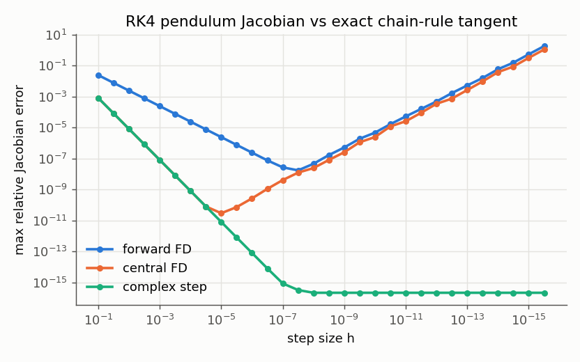
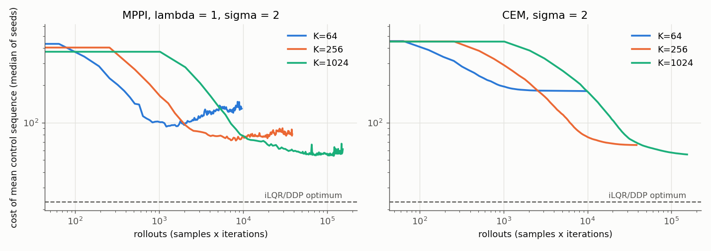

# Results

Generated by `python3 -m experiments.run_all` (Python 3.13.7, NumPy 2.3.3). Everything is a simulation; timings are single-threaded Python wall-clock on one machine and only meaningful relative to each other.

## E1: Derivatives, LQR equivalence, conditioning

Best achievable relative error over h (pendulum, 50 random states, reference = exact RK4 tangent):

| method | best h | best error |
|---|---|---|
| forward FD | 3e-08 | 1.7e-08 |
| central FD | 1e-05 | 3.0e-11 |
| complex step | 1e-08 | 2.2e-16 |

Complex step at h = 1e-20, 1e-50, 1e-100, 1e-200, 1e-300: errors 2.2e-16, 2.2e-16, 2.2e-16, 2.2e-16, 2.2e-16 (no cancellation, so h can be arbitrarily small).

**LQR equivalence** (double integrator, T=50, random initial controls, mu=0):

| method | iterations to optimum | max abs(K - K_riccati) | abs(J - x0'P0x0/2) |
|---|---|---|---|
| ilqr | 1 | 2.7e-15 | 8.9e-16 |
| ddp | 1 | 2.7e-15 | 8.9e-16 |

**Jacobian source inside iLQR** (cart-pole swing-up, T=80, max 400 iterations):

| Jacobians | final cost | iterations | converged | max abs(dJ/dU), exact adjoint |
|---|---|---|---|---|
| complex step | 22.958188 | 327 | True | 8.3e-07 |
| forward FD h=1e-8 | 22.958188 | 320 | True | 1.5e-03 |
| forward FD h=1e-6 | 22.958188 | 327 | True | 3.7e-06 |
| forward FD h=1e-4 | 22.958188 | 313 | True | 6.0e-01 |
| forward FD h=1e-2 | 22.958224 | 327 | True | 7.6e-01 |

**Conditioning of the pendulum swing-up cost J(U)** at the DDP optimum (T=100):

- Hessian eigenvalues (FD of the exact adjoint gradient) span 6.83e-03 .. 9.08e+10.
- Exact gradient at t=6: -8.155e-04. Central FD of J at the same point gives 6.366e+01 (h=1e-03), 7.736e-02 (h=1e-05), -7.767e-04 (h=1e-07).

## E2: iLQR vs DDP convergence

Initial controls are zero, tol = 1e-15. The order estimate is the median of the last three successive-ratio estimates of J - J*, above a floor of 1e-9(1+J*): 1 means linear, 2 means quadratic. Times are Python wall-clock on one machine.

| system | method | final J | iterations | iters to 1e-6 rel | order est. | ms / iter (median) | total s |
|---|---|---|---|---|---|---|---|
| pendulum | ilqr | 13.318785 | 46 | 34 | 1.00 | 5.2 | 0.24 |
| pendulum | ddp | 13.318785 | 57 | 54 | 2.06 | 9.2 | 0.53 |
| cartpole | ilqr | 22.958188 | 362 | 289 | 0.99 | 6.0 | 2.20 |
| cartpole | ddp | 22.958188 | 122 | 119 | 1.47 | 8.1 | 1.08 |
| acrobot | ilqr | 57.411549 | 600 | 530 | 1.00 | 10.0 | 6.05 |
| acrobot | ddp | 57.411549 | 134 | 131 | 1.73 | 13.2 | 1.96 |

**Basins of attraction:** 8 random initial control sequences (N(0, 2^2)) per system. The last column is the fraction of runs that reached the best cost found by either method.

| system | method | median J | best J | worst J | frac. at best |
|---|---|---|---|---|---|
| pendulum | ilqr | 13.319 | 13.319 | 13.319 | 1.00 |
| pendulum | ddp | 13.319 | 13.319 | 13.319 | 1.00 |
| cartpole | ilqr | 22.958 | 22.958 | 22.958 | 1.00 |
| cartpole | ddp | 22.958 | 22.958 | 22.958 | 1.00 |
| acrobot | ilqr | 57.412 | 57.137 | 57.412 | 0.38 |
| acrobot | ddp | 57.274 | 57.137 | 57.412 | 0.50 |

## E3: Sampling planners vs the gradient-based optimum

Cart-pole swing-up, T=80, zero initial controls, 150 iterations, 4 seeds, sigma=2. DDP reaches J* = 22.958 in 121 iterations (1.08 s). Each DDP iteration costs about (n+m)^2 = 25 batched rollouts for derivatives plus 11 line-search rollouts.

| method | K | setting | median final J | best J | median / J* | frac. within 10% | rollouts | s / run |
|---|---|---|---|---|---|---|---|---|
| MPPI | 64 | lambda=0.1 | 148.08 | 139.61 | 6.450 | 0.00 | 9600 | 0.95 |
| MPPI | 64 | lambda=1 | 129.80 | 107.83 | 5.654 | 0.00 | 9600 | 0.94 |
| MPPI | 64 | lambda=10 | 79.39 | 74.14 | 3.458 | 0.00 | 9600 | 0.94 |
| MPPI | 64 | lambda=100 | 97.24 | 90.75 | 4.236 | 0.00 | 9600 | 0.94 |
| MPPI | 256 | lambda=0.1 | 100.95 | 94.86 | 4.397 | 0.00 | 38400 | 1.41 |
| MPPI | 256 | lambda=1 | 80.77 | 77.43 | 3.518 | 0.00 | 38400 | 1.41 |
| MPPI | 256 | lambda=10 | 61.54 | 58.45 | 2.681 | 0.00 | 38400 | 1.40 |
| MPPI | 256 | lambda=100 | 88.22 | 82.26 | 3.843 | 0.00 | 38400 | 1.42 |
| MPPI | 1024 | lambda=0.1 | 68.06 | 66.64 | 2.964 | 0.00 | 153600 | 3.37 |
| MPPI | 1024 | lambda=1 | 61.25 | 56.36 | 2.668 | 0.00 | 153600 | 3.35 |
| MPPI | 1024 | lambda=10 | 56.83 | 56.46 | 2.475 | 0.00 | 153600 | 3.34 |
| MPPI | 1024 | lambda=100 | 83.38 | 80.35 | 3.632 | 0.00 | 153600 | 3.31 |
| CEM | 64 | elite 10% | 179.74 | 159.07 | 7.829 | 0.00 | 9600 | 0.93 |
| CEM | 256 | elite 10% | 66.12 | 58.95 | 2.880 | 0.00 | 38400 | 1.41 |
| CEM | 1024 | elite 10% | 55.50 | 54.70 | 2.417 | 0.00 | 153600 | 3.27 |

## E4: Closed-loop robustness

Cart-pole, 120 control steps (6 s), Gaussian velocity noise of std 0.3 sqrt(dt) per step, 6 seeds per cell. The offline DDP plan uses T=80 and the nominal model. Both MPC controllers use H=40, the nominal model, and the periodic cost with 10x the offline running weight. iLQR-MPC runs 2 iterations per step; MPPI-MPC draws 256 samples per step. Success means within 0.3 rad of upright (mod 2 pi) for the entire final second.

| controller | mass x0.5 | mass x0.75 | mass x1 | mass x1.5 | mass x2 | median ms / step |
|---|---|---|---|---|---|---|
| open-loop plan | 0.00 | 0.00 | 0.00 | 0.00 | 0.00 | 0.00 |
| TVLQR | 0.33 | 0.33 | 0.17 | 0.00 | 0.00 | 0.00 |
| iLQR-MPC | 1.00 | 1.00 | 1.00 | 1.00 | 1.00 | 8.05 |
| MPPI-MPC | 0.00 | 0.00 | 0.00 | 0.00 | 0.00 | 3.87 |

**Ablation** (nominal plant, same noise and seeds):

| controller | warm start | angle cost | success rate |
|---|---|---|---|
| iLQR-MPC | feedback | periodic, running x10 (default) | 1.00 |
| iLQR-MPC | open-loop | periodic | 0.00 |
| iLQR-MPC | feedback | raw quadratic | 1.00 |
| iLQR-MPC | open-loop | raw quadratic | 0.00 |
| iLQR-MPC | feedback | periodic, offline weights | 1.00 |
| MPPI-MPC | shifted mean | periodic, running x10 (default) | 0.00 |
| MPPI-MPC | shifted mean | periodic, running x100 | 0.17 |
| MPPI-MPC, K=1024 | shifted mean | periodic, running x100 | 0.33 |
| MPPI-MPC, H=30 | shifted mean | periodic, running x100 | 0.33 |
| MPPI-MPC, H=30, K=1024 | shifted mean | periodic, running x100 | 1.00 |
